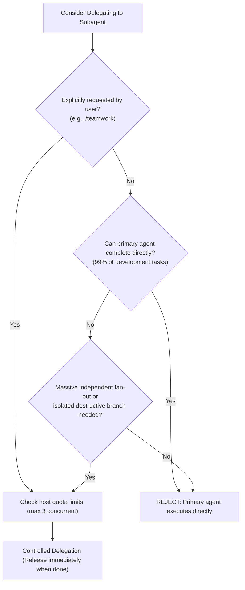

# Antigravity Subagent Governance (`antigravity-subagent-governance`)

Strict subagent restriction guidelines, decision matrix, and concurrency governance rules for **Google Antigravity**.

---

## 🎯 Motivation

In AI agent frameworks like Google Antigravity, delegating tasks to subagents (`invoke_subagent`, `define_subagent`, `swarm`) often seems convenient. However, in practice, premature or unnecessary subagent invocation introduces significant problems:

- **Token Explosion**: Spawning a subagent duplicates system prompts and creates separate multi-turn reasoning loops.
- **Context Fragmentation**: Subagents do not inherit parent conversation history or nuanced requirements.
- **Latency Penalty**: Subagent cold starts and asynchronous message passing add unnecessary turn delays.
- **Quota Saturation**: Uncontrolled concurrency quickly exhausts API rate limits and host governor slots.

This project enforces a **Single-Agent First** policy: the main agent must handle tasks directly using its own workspace tools (`read_file`, `write_file`, `edit_file`, `run_command`, MCP) and only delegate when strict criteria are met.

---

## 🛡️ Core Rules & Prohibitions

### Strict Red Lines (Never Use Subagents)
- ❌ **Code & File Search**: Grepping or finding files (`rg`, `search_files`).
- ❌ **Single-File Changes & Bug Fixes**: Routine edits, bug diagnosis, and test runs.
- ❌ **Shell & Build Execution**: Running compilation, npm/Python tests, or git commands.
- ❌ **Sequential Tasks**: Multi-step workflows where step N depends on step N-1.
- ❌ **Brainstorming / Planning**: The primary agent already has full extended thinking capabilities.

### Strict Exceptions (Only When Allowed)
- ✅ **Explicit User Directive**: The user explicitly requests subagents or teamwork (e.g. `/teamwork`).
- ✅ **Massive Independent Fan-Out**: Static inspection across hundreds of modules exceeding context limits.
- ✅ **Environment Isolation**: High-risk destructive branch evaluations (`workspace: "branch"`).
- ✅ **Extreme Log Excavation**: Parsing tens of thousands of log lines that would pollute main context.

---

## 📂 Repository Structure

```text
antigravity-subagent-governance/
├── README.md
├── rules/
│   └── AGENTS.md                                # Always-on global/workspace rules
└── skills/
    └── subagent-governance/
        ├── SKILL.md                             # Main governance skill & decision matrix
        └── references/
            ├── decision-tree.md                 # Pre-flight checklist & anti-patterns
            └── quota-management.md              # Concurrency limits & host-governor sync
```

---

## 🚀 Installation

### Global Setup (Recommended)
Copy the skill and rule to your global Antigravity configuration directory:

**Windows (PowerShell):**
```powershell
New-Item -ItemType Directory -Force "$env:USERPROFILE\.gemini\config\skills"
Copy-Item -Recurse -Force ".\skills\subagent-governance" "$env:USERPROFILE\.gemini\config\skills\"

# Append governance rule to global AGENTS.md
Get-Content ".\rules\AGENTS.md" | Add-Content "$env:USERPROFILE\.gemini\config\AGENTS.md"
```

**macOS / Linux:**
```bash
mkdir -p ~/.gemini/config/skills
cp -r ./skills/subagent-governance ~/.gemini/config/skills/
cat ./rules/AGENTS.md >> ~/.gemini/config/AGENTS.md
```

### Workspace Setup
Place `AGENTS.md` in your repository root and the skill under `.agents/skills/subagent-governance/`.

---

## 📊 Decision Flow


