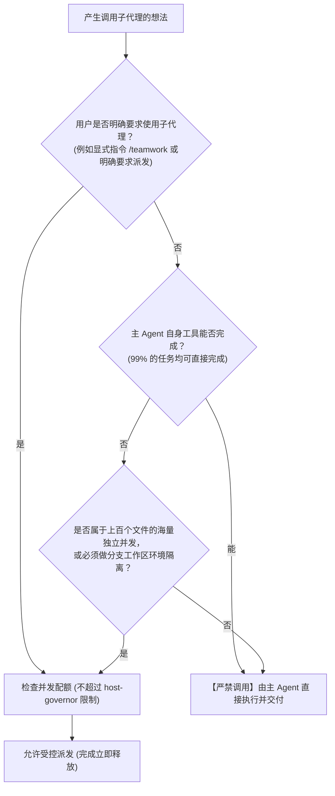

# Antigravity 子代理管控与限制技能 (Subagent Governance)

在 Antigravity 中，主 Agent 自身具备完整强大的上下文理解、文件读写、命令执行与工具调用能力。**派发子代理（Subagent / Swarm）会带来显著的额外 Token 消耗、上下文割裂、通信延迟和系统并发配额负担。**

本技能作为全局管控准则，确立 **“单 Agent 优先（Single-Agent First）”** 的核心原则，并对子代理的调用设置严格红线。

---

## 一、核心原则：单 Agent 优先 (Single-Agent First)

主 Agent 应当默认由自己亲自完成所有任务的调研、编码、调试、测试与验证，**严禁将子代理作为偷懒分流或形式化步骤的手段**。

---

## 二、严禁使用子代理的红线场景 (Strict Prohibitions)

出现以下任一场景时，**绝对禁止**调用 `invoke_subagent` 或 `define_subagent`：

1. ❌ **常规代码与文档查找**：
   - 使用 `rg`、`search_files`、`read_file` 查阅本地代码、日志或配置文件时，严禁派发“搜索子代理”或“研究子代理”。
2. ❌ **单一需求或常规 Bug 修复**：
   - 需求理解、定位根因、修改代码、执行单元测试均应由主 Agent 一气呵成，严禁拆分成“规划子代理 + 编码子代理 + 测试子代理”。
3. ❌ **线性依赖的任务步骤**：
   - 后一步依赖前一步输出的工作流，应在主对话轮次中顺序推进，严禁用子代理串行轮询。
4. ❌ **命令与构建执行**：
   - 运行构建脚本、Git 操作、npm/Python 测试等短时或轻量命令，主 Agent 调用 `run_command` 直接执行即可。
5. ❌ **仅为了“分步思考”或“头脑风暴”**：
   - 主 Agent 本身具备强大的思考链（Thinking Process）能力，严禁为了拆解思路而派发子代理自问自答。

---

## 三、唯一允许使用子代理的例外场景 (Strict Exceptions)

仅在满足以下**严苛条件之一**时，才允许考虑调用子代理：

1. ✅ **用户明确授权或主动请求**：
   - 用户输入明确的子代理派发指令（例如：“用子代理做并发检查”、“派发两个 subagent 去跑测试”、“/teamwork”）。
2. ✅ **海量异构任务的大规模扇出（Fan-Out）**：
   - 涉及数十到上百个独立文件或模块的独立审查，且单个对话上下文窗口（Context Window）绝对无法承载。
3. ✅ **必须隔离的破坏性分支环境**：
   - 需要使用 `workspace: "branch"` 运行可能彻底污染本地存储、具有高破坏性或极耗显存/CPU 的黑盒评测。
4. ✅ **超长独立只读日志挖掘**：
   - 需要一次性分析数万行未知服务日志，为了避免主上下文被大量脏数据彻底冲刷而采用受限的只读研究代理。

---

## 四、并发治理与配额合规 (Concurrency Control)

即使在满足上述例外条件派发子代理时，也必须遵守以下治理机制：

1. **配额检查**：
   - 必须遵循宿主环境并发限制（每个模型默认最多 3 个活跃子代理）。
   - 若系统已启用 `host-governor` 插件，派发前应通过 `governor_status` 查询剩余槽位，必要时通过 `governor_acquire_slot` / `governor_release_slot` 保证稳定性。
2. **生命周期闭环**：
   - 任务完成后必须明确收口，不得遗留挂起或无休止轮询的孤儿子代理。
   - 收集到必要结论后立即汇总并在主会话中交付，不扩散子代理间的多层无效闲聊。

---

## 详细参考与附录

- [决策自检树与反模式对照](references/decision-tree.md)
- [配额与 host-governor 联动规范](references/quota-management.md)
